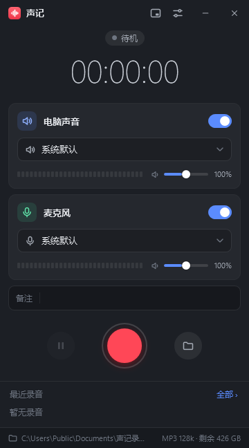
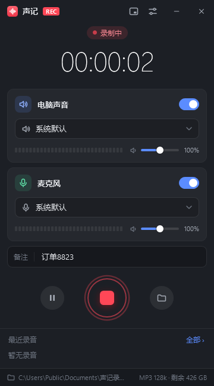
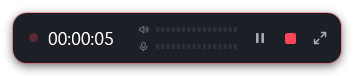

# 声记（ShengJi）

[](https://github.com/DeepFal/ShengJi/actions/workflows/build.yml)
[](https://github.com/DeepFal/ShengJi/releases/latest)
[](LICENSE)

Windows 录音小工具：同时录制「电脑声音」和「麦克风」，实时混成一个文件（可选另存分轨）。
一个窗口、一个红按钮；关掉窗口会收到托盘继续录，托盘图标实时显示录音状态和电平。

<p>
  
  
</p>
<p></p>

## 下载

到 [Releases](https://github.com/DeepFal/ShengJi/releases/latest) 下载最新版：

| 文件 | 说明 |
|---|---|
| `ShengJi_vX.Y.Z_Setup.exe` | 安装版：双击安装，不需要管理员权限；可选桌面快捷方式、开机自启 |
| `ShengJi_vX.Y.Z_Portable.zip` | 便携版：解压即用，设置和日志都放在程序文件夹里 |

- 系统要求：Windows 10 / 11（需要 .NET Framework 4.7.2，Win10 1803 起系统自带）；「按应用录制」需要 Win10 2004 及以上。
- 程序没有数字签名，首次运行如果提示“Windows 已保护你的电脑”，点“更多信息 → 仍要运行”。
- 使用方法见 [使用说明](docs/使用说明.txt)（安装包里也带了一份）。

## 功能

- 电脑声音：系统默认播放设备（跟随切换）、所有播放设备、指定设备，或者**只录某一个应用**
- 麦克风：默认或指定设备；指定的设备拔掉会自动退回默认，插回来自动切回，录音不中断
- MP3 / WAV；可选分轨（混音 + 电脑声音 + 麦克风三个文件）、按时长自动分段
- 备注写进文件名，录音中途再填也行，保存时自动改名
- 全局快捷键、迷你悬浮条、托盘动态图标、录音时阻止休眠、开机自启

## 构建

需要 .NET SDK 6 及以上（编译 net472），打安装包还需要 Inno Setup 6.5+。

```powershell
powershell -ExecutionPolicy Bypass -File build.ps1                  # 版本号取最近的 git 标签
powershell -ExecutionPolicy Bypass -File build.ps1 -Version 1.2.3   # 指定版本号
powershell -ExecutionPolicy Bypass -File build.ps1 -NoInstaller     # 只出便携版
```

产物在 `dist\`：`声记_vX.Y.Z_安装版.exe`、`声记_vX.Y.Z_便携版.zip`。

## 版本与发布

版本号以 git 标签（`vX.Y.Z`）为准，由 [GitHub Actions](.github/workflows/build.yml) 自动维护，不需要手改：

- **推送到 main**：编译 + 界面自检。如果程序相关文件（`src/`、`installer/`、`docs/`、`build.ps1`）自上个版本以来有改动，
  自动把修订号 +1、打标签并发布 Release（附安装版、便携版和 SHA-256）。只改 README 之类的不会发版。
- **手动发版**：Actions → 编译与发布 → Run workflow，选 `patch` / `minor` / `major`。
- **Pull Request**：只编译和自检；安装包和界面截图可以在该次运行页面的 Artifacts 里下载。
- 提交信息里写 `[skip ci]` 可以跳过这次运行。

Release 里的“更新内容”取自上个版本以来改动了程序文件的提交标题，所以提交标题写成一句给用户看的话就好。

## 目录

```
src/ShengJi/          程序源码（C# / WPF，.NET Framework 4.7.2，无第三方依赖）
  Interop/            Windows Core Audio、Media Foundation 等 COM / Win32 声明
  Audio/              采集（设备回环 / 按应用回环 / 麦克风）、时间轴对齐、混音引擎
  Recording/          录音器（暂停/停止精确定位、分段、分轨）、MP3/WAV 写入
  Core/               设置、路径、日志、快捷键、开机启动等
  UI/                 主窗口、迷你悬浮条、托盘图标、主题样式
  SelfTest.cs         自检（--selftest），验证音频链路
installer/            Inno Setup 安装脚本 + 简体中文语言文件
docs/                 随程序分发的「使用说明」、便携版标记文件，以及 README 截图
tools/make-icon.ps1   生成 app.ico
build.ps1             一键打包：Release 编译 → 便携版 zip → 安装包
.github/workflows/    自动编译、版本号递增与发布
```

## 关键设计

- **电脑声音四种来源**：系统默认播放设备（跟随切换）/ 所有播放设备 / 指定设备 / 按应用（Win10 2004+ 进程回环，
  按 exe 名记住，自动定位同名进程树的根进程，应用重启后自动重连）。
- **统一时间轴**：所有采集源按 QPC 时间戳（不可信时用到达时间）写入各自的环形缓冲；混音线程以固定 250ms 延迟
  顺序读取。没有数据的地方就是静音，所以“没声音时不出包”的回环设备也能对齐。
- **时钟漂移补偿**：对每路采集用平滑后的时间偏差微调重采样比例（±0.3% 以内，Hermite 插值），偏差超过 120ms 才硬对齐。
- **设备变化**：调度线程每秒（以及收到设备通知时）重新计算需要的采集源；指定设备断开时自动退回默认设备，恢复后切回；
  采集出错按 0.5s→10s 退避重试；混音线程有看门狗。
- **防丢数据**：MP3 由系统 MP3 编码器 MFT 编码，帧由我们自己写文件，每秒交给系统、每 10 秒强制落盘；
  WAV 每次刷新回写文件头；WAV 每 5 小时自动换文件（4GB 限制）。没有 MP3 编码器的系统自动改用 WAV。
- **便携版**：exe 同目录有 `portable.txt` 时，设置和日志放在旁边的 `Data` 文件夹；否则放在 `%APPDATA%\ShengJi`。

## 调试参数

- `--selftest <目录> [--tone]`：自检，结果写入 `<目录>\selftest.txt`；`--tone` 会播放约 2.5 秒小音量提示音来验证回环。
- `--ui-shot <目录>`：把各界面状态渲染成 PNG 后退出（不保存设置）。CI 每次都会跑一遍并上传截图。
- `--minimized`：启动时只显示托盘图标（开机自启使用）。

## 许可证

[MIT](LICENSE)
